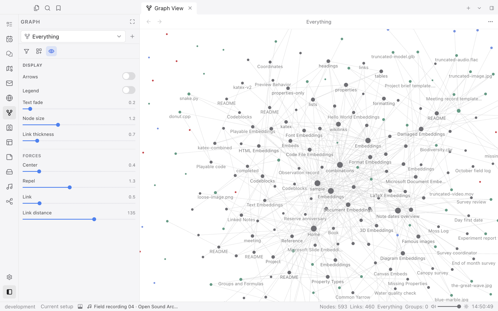
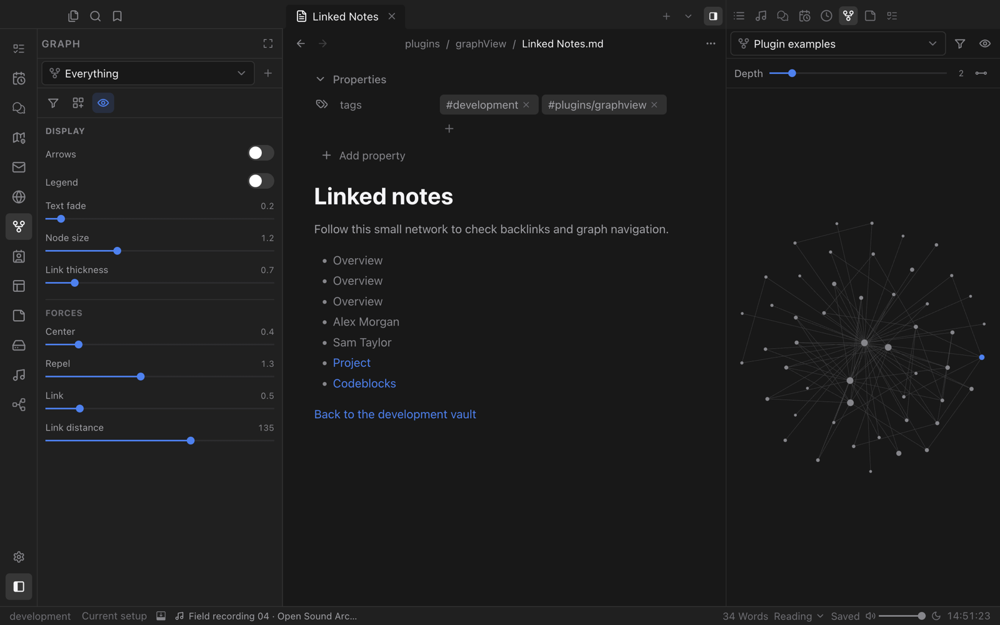

# Graph View

See how your notes connect. Graph View draws your whole realm as a living network, with filters, colour groups, saved graphs and a local graph that follows the file you are working on.

## Your realm as a network

Every note is a node and every link an edge. Zoom in to read labels, drag nodes around and click one to open it. Tune the display and forces from the sidebar: text fade, node size, link thickness, repel strength and link distance.

- **Saved graphs.** Keep several graphs with their own filters and settings, and switch between them by name.
- **Filters.** Start from the whole realm or a query such as `tag:#project` or `path:"Projects/"`, then exclude what you do not need.
- **Sources.** Tags, attachments, orphans and notes from plugins each get their own switch and colour.
- **Search.** Find a note in the graph from the right sidebar and step through matches.

## The local graph

Open Graph View in the right sidebar to see the neighbourhood of the file you are reading. Choose how many connections deep to go, from 1 to 10, and turn arrows on to see link direction.
